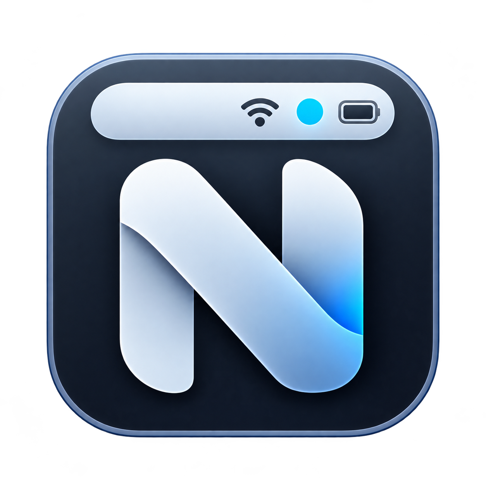

<p align="center">
  
</p>

# NexaBar

**Your Mac. One glance away.**

NexaBar is a native macOS menu-bar utility combining real-time hardware monitoring, per-application audio mixing, clipboard history (text & images), and system shortcuts into a single sleek menu-bar application.

---

## 🌟 Key Features

- **📊 Hardware System Monitor**: Real-time CPU usage, Memory usage, SSD Storage, CPU Temperature (via SMC sensors), and Network Download/Upload rates.
- **🔊 Per-App Audio Mixer**: Individual volume controls for running applications (Brave, Chrome, Discord, Spotify, Teams, etc.) using macOS CoreAudio process taps (`AudioHardwareCreateProcessTap`) and device switching.
- **🎧 Device Output Selector**: Instantly switch output between AirPods, Speakers, HDMI, or HiFi DACs with one click.
- **📋 Rich Clipboard History**: Persistent text & image history with thumbnail previews, 8-hour auto-retention, and global `Cmd + Shift + V` hotkey toggle.
- **📸 Screenshot Capture**: Quick interactive area selection straight to clipboard and history.
- **⚙️ Distinct Menu Bar Metric Icons & Layouts**:
  - **Balanced**: Displays CPU, RAM, SSD Storage, and Internet transfer speed, each with their own identifying SF Symbol icon (`cpu`, `memorychip`, `internaldrive`, `network`).
  - **Compact**: Space-saving dual layout featuring CPU and RAM with individual icons.
  - Rendered with monospaced digit formatting and `.variableLength` to fit notched MacBooks cleanly without text jumping or clipping.
- **🚀 In-App Auto-Updater & Patch Notes**:
  - Seamless background check against GitHub Releases (`MahdiHassanGo/NexaBar`).
  - Interactive Patch Notes dialog displaying markdown release notes directly in-app.
  - 1-Click automated download, in-place `.app` bundle replacement, and instant relaunch.
  - Automated GitHub Actions workflow (`.github/workflows/release.yml`) builds and attaches `NexaBar.dmg` on every new release.

---

## 🔒 Permissions & Setup (Per-App Audio)

For per-application volume sliders to function on macOS 14.2+, NexaBar requires **Screen & System Audio Recording** permission.

### How to Add NexaBar in System Settings:

1. Open **System Settings** on your Mac.
2. Navigate to **Privacy & Security → Screen & System Audio Recording** (or *System Audio Recording Only*).
3. Click the **`+` (Plus)** button at the bottom of the app list.
4. In the Finder window, navigate to the **Applications** folder, select **NexaBar**, and click **Open**.
5. Ensure the toggle switch next to **NexaBar** is set to **ON**.

---

## 📦 Building & Packaging

NexaBar is built using Swift Package Manager.

### Local Development

```bash
# Run locally from Terminal
swift run NexaBar
```

### Create Release DMG Installer

To build the standalone `.app` bundle and generate `NexaBar.dmg`:

```bash
chmod +x ./Scripts/*.sh
./Scripts/build_dmg.sh
```

---

## 🚀 Publishing Updates (Over-the-Air Auto-Updates)

When you push a new release to GitHub, every laptop running NexaBar will automatically detect the update, show your patch notes, and update itself.

### Method 1: Using GitHub Web UI (Recommended)
1. Go to **Releases → Draft a new release** on GitHub.
2. Enter a tag (e.g. `v0.3.0`) and Release Title.
3. Write your **Patch Notes** in the description (Markdown headings, bullet points, etc.).
4. Click **Publish release**.
5. The GitHub Actions workflow (`.github/workflows/release.yml`) will automatically build the Universal `NexaBar.dmg` and attach it to the release.
6. Current NexaBar installations will detect `v0.3.0`, display your patch notes, and allow users to update with 1 click!

### Method 2: From Terminal
You can also use the included release script:

```bash
./Scripts/release.sh 0.3.0 "Here are the patch notes for v0.3.0"
```

---

## 🛠 Tech Stack

- **Language**: Swift 5.10 / macOS SDK 14+
- **UI Framework**: Native AppKit + SwiftUI
- **Audio Engine**: CoreAudio (Process Taps, Private Aggregate Devices, IOProcs)
- **Persistence**: UserDefaults + Local PNG disk store in `~/.nexabar/clipboard_images/`

---

## 📜 License

NexaBar Pro © 2026. All rights reserved.
